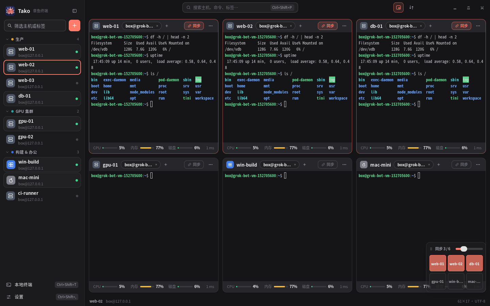
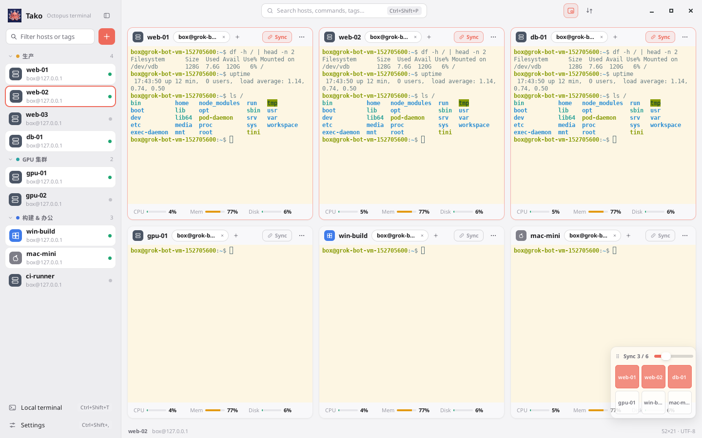
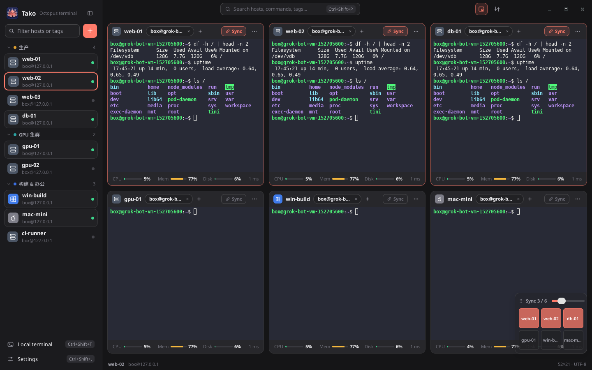
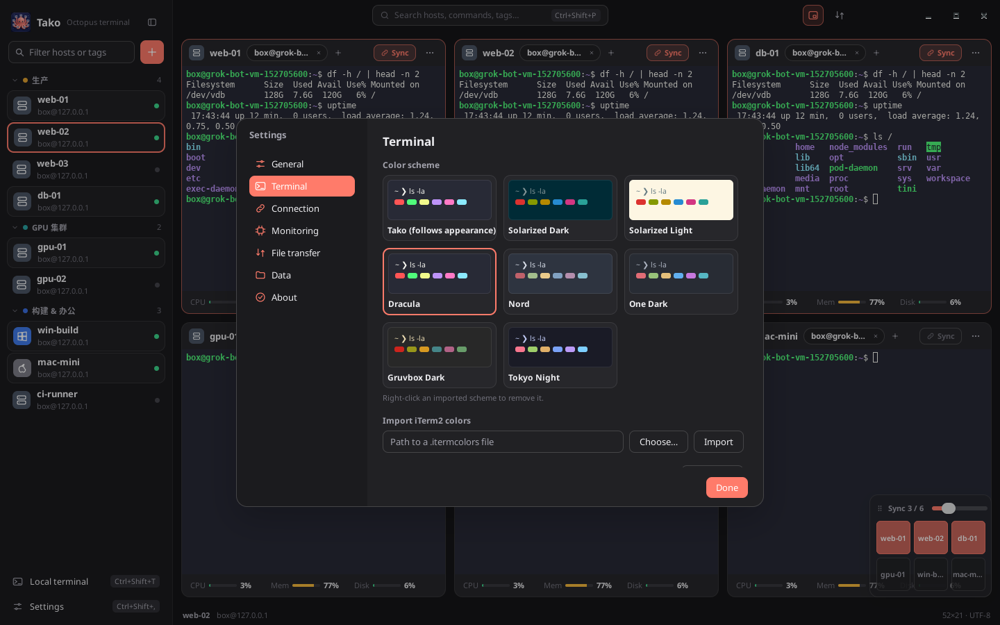
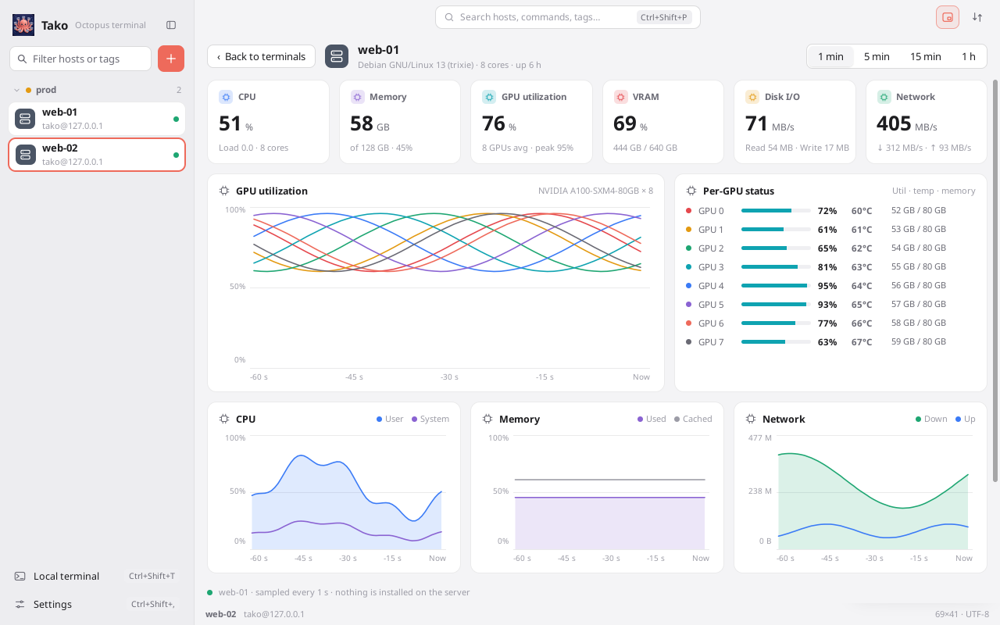
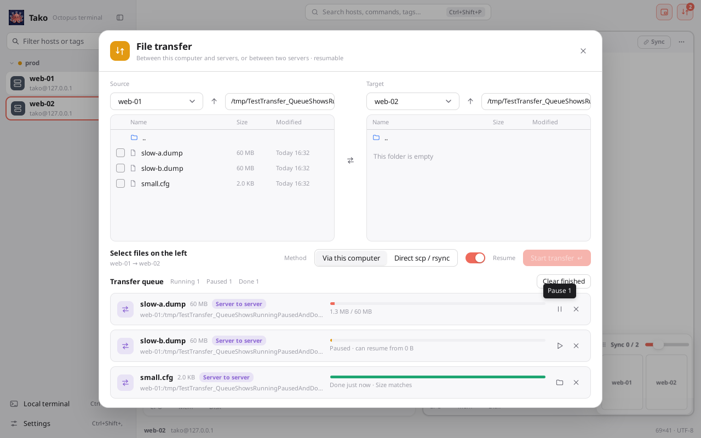

# Tako (章鱼终端)

[English](README.md) · [简体中文](README.zh-CN.md)

[](LICENSE)
[](https://github.com/zdva/tako/actions/workflows/ci.yml)
[](go.mod)

Tako is a desktop terminal for a fleet of servers. It keeps many SSH (and local)
terminals on one screen as a grid of *blocks*, reconnects the ones whose network
dropped, and remembers what you had open. It is written in Go with the
[MyGo](https://github.com/egoist/mygo) native UI toolkit, for macOS, Windows and Linux.

> **Status: v0.4.0, the first release candidate.** Everything in the plan is
> built and tested on Linux; it has **not** yet been run on real macOS or Windows
> machines, nothing is published and the installers are unsigned. See
> [docs/RELEASE.md](docs/RELEASE.md) for the checklist that needs a person, and
> [docs/SPEC.md](docs/SPEC.md) and [docs/TECH-PLAN.md](docs/TECH-PLAN.md) for the plan.



| Light, Solarized Light terminals | Dark, Dracula terminals | Settings, Terminal page |
|---|---|---|
|  |  |  |

More in [docs/screenshots/m4](docs/screenshots/m4) (earlier milestones:
[m3](docs/screenshots/m3), [m2](docs/screenshots/m2), [m1](docs/screenshots/m1)).

## What works in M4

- **Settings window** (`Ctrl+Shift+,`): language, appearance, terminal color
  scheme, font, keepalive, monitoring, transfers, data and About. Everything
  applies at once, with no restart. See [ADR 0017](docs/adr/0017-settings-window-and-schemes.md).
- **Dark mode and color schemes**: the dark theme follows the design mockup;
  eight schemes (Tako, Solarized Dark / Light, Dracula, Nord, One Dark, Gruvbox
  Dark, Tokyo Night) and import of iTerm2 `.itermcolors`. Open terminals recolor
  live.
- **English and 简体中文**, complete. A pseudo-locale test fails on any string
  that bypasses the tables or does not fit; numbers, dates and the clock follow the
  system region. See [ADR 0019](docs/adr/0019-i18n-pseudo-and-regional-formats.md).
- **Import and export**: hosts from Xshell, SecureCRT, Termius and `~/.ssh/config`;
  export without any secret and import it on another computer. Saved passwords are
  never imported. See [docs/IMPORT.md](docs/IMPORT.md) and
  [ADR 0018](docs/adr/0018-host-importers.md).
  **The parsers were written from public documentation, not from real exports.**
- **Accessibility and input methods**: roles, names and Tab stops everywhere,
  keyboard activation, IME composition in fields and terminals.
- **Crash reports and "Copy diagnostics"** (scrubbed, nothing is uploaded),
  [ADR 0020](docs/adr/0020-crash-reports-and-diagnostics.md).
- **Packaging and updates**: tar.gz + install script, `.deb`, `.rpm`, PKGBUILD,
  dmg and NSIS installers built by CI, signed (ed25519) auto-update from GitHub
  Releases; no Apple or Windows certificates,
  [ADR 0021](docs/adr/0021-unsigned-releases-and-signed-updates.md),
  [docs/RELEASE.md](docs/RELEASE.md).
- Not supported on purpose: encodings other than UTF-8 ([ADR 0005](docs/adr/0005-utf8-only.md)).

## What works in M3

| Monitor page | Transfer sheet |
|---|---|
|  |  |

The monitor page above shows a GPU machine from a Tester run with seeded
history; the real-window shots are in [docs/screenshots/m3](docs/screenshots/m3).

- **Monitoring with nothing installed on the server.** Every SSH block's
  footer shows CPU, memory, disk and (when `nvidia-smi` or `rocm-smi` exist) GPU
  bars; click it (or `Ctrl+Shift+Alt+M`) for the monitor page: stat cards,
  CPU / memory / network charts for the last 1, 5, 15 or 60 minutes, per-GPU
  status, disks and a description of the machine. Linux reads `/proc` and `df`,
  macOS `top`, `vm_stat`, `iostat`, Windows PowerShell CIM; one command per
  sample over the session the shell already uses. The window is redrawn only
  when a footer visibly changes. See [ADR 0012](docs/adr/0012-agentless-monitoring.md).
  **The macOS, Windows and GPU parsers are tested with fixtures composed by
  hand from the tools' documented formats, not with recordings; only Linux was
  measured on a real machine.**
- **File transfer** (`Ctrl+Shift+Alt+T`, host menu *Transfer files…*, or drop
  files on the target pane): upload, download and server to server, through
  this computer (the bytes are never written to disk here) or, if you allow it
  in Settings, directly with `scp`/`rsync` using your SSH agent for that one
  command. Part files, automatic retry, resume after a lost connection with a
  checksum check, same-name policy (ask / overwrite / skip), a queue with
  speed, time left, pause, resume and cancel. See
  [ADR 0013](docs/adr/0013-transfer-queue-and-resume.md) and
  [ADR 0015](docs/adr/0015-direct-server-to-server.md).
- **Folders from OSC 7**: the transfer sheet opens in the folder your shell
  reports ([docs/OSC7.md](docs/OSC7.md)).

## What works in M2

- **Synchronized input**: a synced block has a coral border and a small chip.
  Turn sync on from the chip, the minimap, the command palette, the shortcuts
  or the right-click menus; all on/off with `Ctrl+Shift+Alt+A`. A block whose
  connection is down is paused and the others carry on. See
  [ADR 0010](docs/adr/0010-sync-ui-and-minimap.md).
- **Minimap**: a floating 176 px panel that is translucent at rest and opaque
  under the pointer. Click a square to toggle sync, drag a box to select
  (`⇧` adds, `⌥` inverts), drag squares to reorder, drag the panel to a corner,
  opacity slider.
- **Split layouts**: drag a divider; it snaps to ½, ⅓, ⅔ with a guide line
  (`⌥` turns snapping off). The layout and sync state survive a restart.
  See [ADR 0009](docs/adr/0009-manual-layout-tree.md).
- Full [keyboard shortcuts](docs/SHORTCUTS.md), right-click menus (block
  header, tab, sidebar host and tag, minimap), block rename, zoom a block,
  search in the terminal, and a custom title bar.

## Also in M1

- **SSH**: password, public key (OpenSSH, PEM, PuTTY `.ppk`), SSH agent and
  keyboard-interactive authentication; jump-host chains; SOCKS5 and HTTP
  proxies; keep-alives; MaxSessions fallback (opens an extra connection).
- **Resilient panes**: when the link drops, the block shows a reconnect banner,
  keeps its scrollback, retries with backoff (1, 2, 5, 10, 30 s) and never
  replays what you typed during the outage. See [ADR 0006](docs/adr/0006-session-pane-contract.md).
- **Host keys**: Tako's own `known_hosts`; a changed key is always refused
  with both fingerprints shown. See [ADR 0004](docs/adr/0004-host-key-policy.md).
- **Secrets** only in the system keychain, never in files or logs.
  See [ADR 0003](docs/adr/0003-secrets-in-keychain.md).
- **Grid of blocks**: 1 / 2 / 2×2 / 3×2 / scrolling, tabs per block, local
  shells, right-click menus, command palette, English and 简体中文, light and dark.
- **Import** hosts from `~/.ssh/config` (`Include`, `ProxyJump`, `IdentityFile`).
- **Session restore**: quit or crash (even `kill -9`) and the blocks and tabs
  come back and reconnect, usually well under a second.

## Install and run

Release builds are not published yet (see [docs/RELEASE.md](docs/RELEASE.md)). Build from source
(Go 1.27.3 or newer):

```sh
git clone <repository-url> tako && cd tako
make run            # go run ./cmd/tako
make build          # ./tako (a plain build downloads libghostty-vt on first use)
make package-linux  # packaged app in build/linux-amd64 (libghostty-vt bundled)
make build-all      # Windows, macOS (universal) and Linux, amd64 and arm64
```

Packaged builds (`mygo build`) ship the terminal engine next to the executable
and work offline. A plain `go build` binary fetches `libghostty-vt` from the
MyGo releases into your user cache the first time a terminal opens, and checks
its SHA-256.

Binaries are **not code-signed** (a decision, see
[ADR 0021](docs/adr/0021-unsigned-releases-and-signed-updates.md)): macOS Gatekeeper
and Windows SmartScreen will warn the first time; [docs/MANUAL.md](docs/MANUAL.md)
says how to open the app, and [docs/RELEASE.md](docs/RELEASE.md) how to add signing later.
Updates are verified with an ed25519 signature regardless.

### Keyboard

The complete table is in [docs/SHORTCUTS.md](docs/SHORTCUTS.md).

The primary modifier is `Ctrl+Shift` on Linux and Windows (so plain `Ctrl+C`
still reaches the shell) and `⌘` on macOS.

| Keys | Action |
|---|---|
| `Ctrl+Shift+P` | Command palette (hosts, commands) |
| `Ctrl+Shift+N` | Add host |
| `Ctrl+Shift+T` | New tab / local terminal |
| `Ctrl+Shift+W` | Close tab · `Ctrl+Shift+Alt+W` close block |
| `Ctrl+Shift+1…9` | Switch tab |
| `Ctrl+Shift+Alt+←↑→↓` | Move focus between blocks |
| `Ctrl+Shift+Alt+S` | Toggle synchronized input for the focused block |
| `Ctrl+Shift+Alt+A` | Sync all blocks on / off |
| `Ctrl+Shift+Alt+G` | Show / hide the minimap |
| `Ctrl+Shift+F` | Search in the terminal |
| `Ctrl+Shift+B` | Toggle the sidebar |
| `Ctrl+Shift+,` | Settings |

### Where data lives

| | Linux | macOS | Windows |
|---|---|---|---|
| Config (`hosts.json`, `known_hosts`, `settings.json`) | `~/.config/tako` | `~/Library/Application Support/Tako` | `%AppData%\Tako` |
| State (`session.json`, logs, lock) | `~/.local/state/tako` | same as config | `%LocalAppData%\Tako` |

Override with `TAKO_CONFIG_DIR` and `TAKO_STATE_DIR`. On a machine without a
credential store (a headless Linux box without Secret Service), "remember
password" lasts for the running session only, and Tako says so.

## Develop

```sh
make check          # gofmt, vet, golangci-lint, go test -race, coverage gate (80% core)
make integration    # against a real OpenSSH (scripts/fetch-sshd.sh downloads a portable one)
make e2e            # live window under Xvfb: idle CPU/RSS, cold start, kill -9 recovery
make screenshots    # real-window screenshots into docs/screenshots/m4 (MILESTONE=m3 for an older set)
make vuln           # govulncheck
make fuzz           # the parsers: ssh_config, ppk, Xshell/SecureCRT/Termius files, iTerm2 colors
make build-all      # every platform, cross-compiled
```

Read [AGENTS.md](AGENTS.md) for the layout and conventions and
[CONTRIBUTING.md](CONTRIBUTING.md) for how to send a change.
[docs/TESTING.md](docs/TESTING.md) explains the test environments; the user guide is
[docs/MANUAL.md](docs/MANUAL.md).

## Notes for maintainers

- The public repository and the Go module path are
  <https://github.com/zdva/tako>.
- The maintainer e-mail in `mygo.json` and `packaging/nfpm.yaml.tmpl`
  (`tako@example.invalid`) is a **placeholder**; replace it with a real address
  before the first public release.

## License

Tako is free software: you can redistribute it and/or modify it under the terms of
the [GNU General Public License](LICENSE) as published by the Free Software
Foundation, either version 3 of the License, or (at your option) any later version
(**GPL-3.0-or-later**). It is distributed in the hope that it will be useful, but
**without any warranty**; see the license for details.

Third-party components keep their own licenses, all compatible with the GPL;
they are listed with their notices in [THIRD_PARTY_LICENSES.md](THIRD_PARTY_LICENSES.md),
and the reasoning is in [ADR 0022](docs/adr/0022-license-gpl-3-or-later.md).
Contributions are accepted under the same license
(see [CONTRIBUTING.md](CONTRIBUTING.md)).
