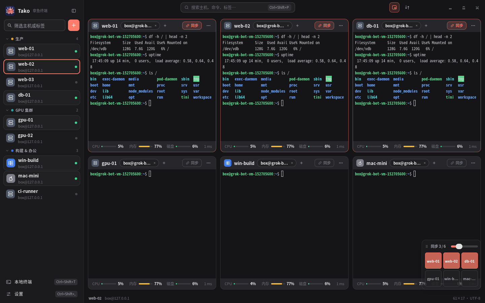
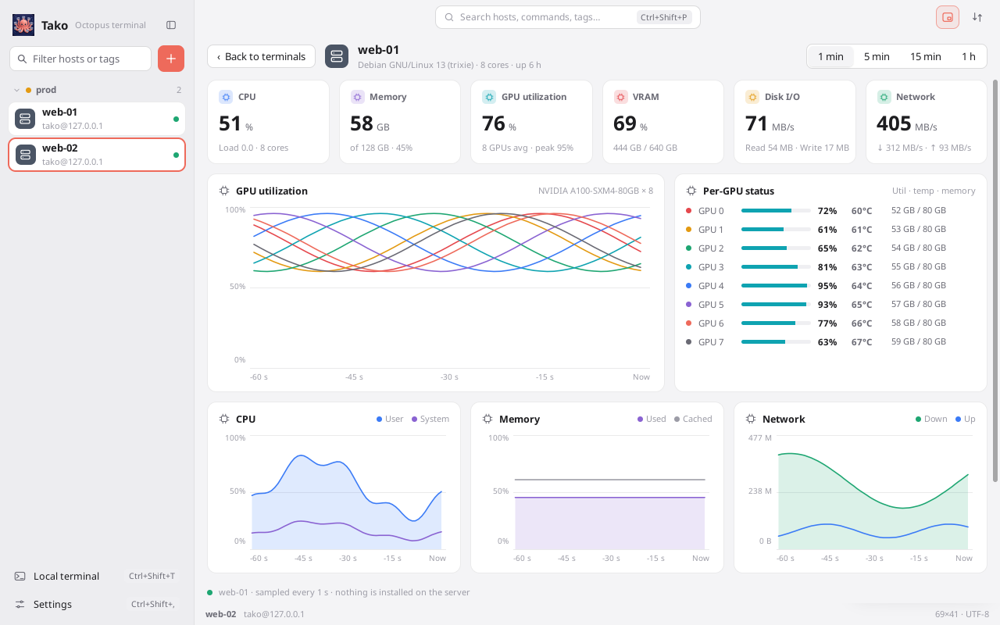

# Tako（章鱼终端）

[English](README.md) · [简体中文](README.zh-CN.md)

Tako 是管理一群服务器的桌面终端。它把许多 SSH（和本地）终端放在同一屏的网格里（每个叫一个“块”），网络断了的块会自动重连，下次打开还记得你开过什么。用 Go 和 [MyGo](https://github.com/egoist/mygo) 原生 UI 工具包写成，支持 macOS、Windows、Linux。

> **状态：v0.4.0，第一个发布候选。** 计划内的功能都已完成，并在 Linux 上测过；**还没有**在真实的 macOS 和 Windows 上跑过，没有发布任何东西，安装包也没有签名。需要人来做的检查清单见 [docs/RELEASE.md](docs/RELEASE.md)，规划见 [docs/SPEC.md](docs/SPEC.md)、[docs/TECH-PLAN.md](docs/TECH-PLAN.md)。



| 浅色，Solarized Light 终端 | 深色，Dracula 终端 | 设置，终端页 |
|---|---|---|
|  |  |  |

更多截图在 [docs/screenshots/m4](docs/screenshots/m4)（之前的里程碑：[m3](docs/screenshots/m3)、[m2](docs/screenshots/m2)、[m1](docs/screenshots/m1)）。

## M4 能做什么

- **设置窗口**（`Ctrl+Shift+,`）：语言、外观、终端配色、字体、保活、监控、传输、数据与关于；改动立即生效，无需重启。见 [ADR 0017](docs/adr/0017-settings-window-and-schemes.md)。
- **深色模式与配色方案**：深色主题对照设计稿；8 套配色（Tako、Solarized 深 / 浅、Dracula、Nord、One Dark、Gruvbox Dark、Tokyo Night），可导入 iTerm2 的 `.itermcolors`；已打开的终端实时换色。
- **完整的中文和英文**：伪语言测试会在任何绕过语言表、或放不下的字符串上失败；数字、日期和时钟按系统地区格式显示。见 [ADR 0019](docs/adr/0019-i18n-pseudo-and-regional-formats.md)。
- **导入与导出**：从 Xshell、SecureCRT、Termius 和 `~/.ssh/config` 导入主机；导出文件不含任何秘密，可在另一台电脑导入。保存的密码**不会**被导入。见 [docs/IMPORT.md](docs/IMPORT.md)、[ADR 0018](docs/adr/0018-host-importers.md)。**这些解析器依据公开文档编写，没有用真实导出文件验证过。**
- **无障碍与输入法**：各控件都有角色、名称和 Tab 停靠点，可用键盘操作；文本框和终端内支持输入法组合输入。
- **崩溃报告与“复制诊断信息”**（已脱敏，不会上传任何东西），见 [ADR 0020](docs/adr/0020-crash-reports-and-diagnostics.md)。
- **打包与更新**：tar.gz + 安装脚本、`.deb`、`.rpm`、PKGBUILD，dmg 和 NSIS 安装包由 CI 构建；从 GitHub Releases 做 ed25519 签名的自动更新；不需要 Apple 或 Windows 证书，见 [ADR 0021](docs/adr/0021-unsigned-releases-and-signed-updates.md)、[docs/RELEASE.md](docs/RELEASE.md)。
- 有意不支持：UTF-8 以外的编码（[ADR 0005](docs/adr/0005-utf8-only.md)）。

## M3 能做什么

| 监控页 | 传输面板 |
|---|---|
|  |  |

上图的监控页来自带预置历史的 Tester 截图（GPU 机器）；真实窗口截图在 [docs/screenshots/m3](docs/screenshots/m3)。

- **服务器上什么都不用装的监控**：每个 SSH 块底部显示 CPU、内存、磁盘，以及（有 `nvidia-smi` / `rocm-smi` 时）GPU 的条；点它（或 `Ctrl+Shift+Alt+M`）进入监控页：数据卡片、最近 1 / 5 / 15 / 60 分钟的 CPU、内存、网络曲线、每块 GPU 的状态、磁盘与机器说明。Linux 读 `/proc` 和 `df`，macOS 用 `top`、`vm_stat`、`iostat`，Windows 用 PowerShell CIM；每次采样只跑一条命令，走终端本来就在用的会话。只有底部的数值肉眼可见地变了才会重绘窗口。见 [ADR 0012](docs/adr/0012-agentless-monitoring.md)。**macOS、Windows 和 GPU 的解析器用的是按工具文档格式手写的样例，不是实机录制；只有 Linux 在真机上测过。**
- **文件传输**（`Ctrl+Shift+Alt+T`、主机菜单“传输文件…”，或把文件拖到目标面板）：上传、下载、服务器之间互传；可经本机中转（数据不落本机磁盘），也可在设置里允许后直连 `scp` / `rsync`（仅为这一条命令转发你的 SSH Agent）。分片文件、自动重试、断线后从断点续传并校验、同名文件策略（询问 / 覆盖 / 跳过）、带速度和剩余时间的队列，可暂停、继续、取消。见 [ADR 0013](docs/adr/0013-transfer-queue-and-resume.md)、[ADR 0015](docs/adr/0015-direct-server-to-server.md)。
- **用 OSC 7 取得当前目录**：传输面板默认打开 shell 报告的目录（[docs/OSC7.md](docs/OSC7.md)）。

## M2 能做什么

- **同步输入**：同步中的块有一圈珊瑚色边框和一个小标签。可从标签、小地图、命令面板、快捷键或右键菜单开关；`Ctrl+Shift+Alt+A` 全部开 / 关。连接断开的块会暂停，其他块不受影响。见 [ADR 0010](docs/adr/0010-sync-ui-and-minimap.md)。
- **小地图**：悬浮的 176 px 面板，静止时半透明、鼠标悬停时不透明。点方块切换同步，拖框选择（`⇧` 追加、`⌥` 反选），拖方块重排，拖面板吸附到四角，透明度滑块。
- **分割布局**：拖分隔线，自动吸附 ½、⅓、⅔ 并显示参考线（按住 `⌥` 不吸附）；布局和同步状态重启后保留。见 [ADR 0009](docs/adr/0009-manual-layout-tree.md)。
- 完整的[快捷键](docs/SHORTCUTS.md)、右键菜单（块头、标签页、侧栏主机与标签、小地图）、块重命名、放大单个块、终端内搜索、自定义标题栏。

## 另外 M1 已有

- **SSH**：密码、公钥（OpenSSH、PEM、PuTTY `.ppk`）、SSH Agent、键盘交互认证；跳板机链；SOCKS5 和 HTTP 代理；保活；服务器 MaxSessions 不够时自动多开一条连接。
- **不怕断线的面板**：链路断开时，块里显示重连横幅，滚动历史保留，按 1、2、5、10、30 秒退避重试，断线期间敲的键**不会**在恢复后补发。见 [ADR 0006](docs/adr/0006-session-pane-contract.md)。
- **主机密钥**：Tako 自己的 `known_hosts`；密钥变了**一律拒绝**并显示新旧指纹。见 [ADR 0004](docs/adr/0004-host-key-policy.md)。
- **秘密**只放系统钥匙串，不进文件和日志。见 [ADR 0003](docs/adr/0003-secrets-in-keychain.md)。
- **块网格**：1 / 2 / 2×2 / 3×2 / 超出后滚动；每块多标签页；本地终端；右键菜单；命令面板；中英文；浅色与深色。
- **导入** `~/.ssh/config`（支持 `Include`、`ProxyJump`、`IdentityFile`）。
- **会话恢复**：正常退出或崩溃（包括 `kill -9`）后，块和标签页会恢复并自动重连，通常不到一秒。

## 安装与运行

暂无发布的安装包（见 [docs/RELEASE.md](docs/RELEASE.md)），请从源码构建（Go 1.27.3 或更新）：

```sh
git clone <仓库地址> tako && cd tako
make run            # go run ./cmd/tako
make build          # ./tako（普通构建会在首次使用时下载 libghostty-vt）
make package-linux  # 打包的应用在 build/linux-amd64（自带 libghostty-vt）
make build-all      # Windows、macOS（通用）、Linux，amd64 与 arm64
```

打包版（`mygo build`）把终端引擎放在可执行文件旁边，离线也能用。普通 `go build` 的程序会在第一次打开终端时，从 MyGo 的发布页下载 `libghostty-vt` 到用户缓存目录，并校验 SHA-256。

二进制**没有代码签名**（这是既定决定，见 [ADR 0021](docs/adr/0021-unsigned-releases-and-signed-updates.md)）：macOS 的 Gatekeeper 和 Windows 的 SmartScreen 第一次会提示警告，打开方法见 [docs/MANUAL.md](docs/MANUAL.md)，以后如何加签名见 [docs/RELEASE.md](docs/RELEASE.md)。无论如何，更新包都会用 ed25519 签名校验。

### 快捷键

完整列表见 [docs/SHORTCUTS.md](docs/SHORTCUTS.md)。

Linux 和 Windows 的主修饰键是 `Ctrl+Shift`（这样单独的 `Ctrl+C` 还能到达 shell），macOS 用 `⌘`。

| 按键 | 作用 |
|---|---|
| `Ctrl+Shift+P` | 命令面板（主机、命令） |
| `Ctrl+Shift+N` | 添加主机 |
| `Ctrl+Shift+T` | 新标签页 / 本地终端 |
| `Ctrl+Shift+W` | 关闭标签页 · `Ctrl+Shift+Alt+W` 关闭块 |
| `Ctrl+Shift+1…9` | 切换标签页 |
| `Ctrl+Shift+Alt+←↑→↓` | 在块之间移动焦点 |
| `Ctrl+Shift+Alt+S` | 切换当前块的同步输入 |
| `Ctrl+Shift+Alt+A` | 全部块同步开 / 关 |
| `Ctrl+Shift+Alt+G` | 显示 / 隐藏小地图 |
| `Ctrl+Shift+F` | 终端内搜索 |
| `Ctrl+Shift+B` | 显示 / 隐藏侧栏 |
| `Ctrl+Shift+,` | 设置 |

### 数据放在哪

| | Linux | macOS | Windows |
|---|---|---|---|
| 配置（`hosts.json`、`known_hosts`、`settings.json`） | `~/.config/tako` | `~/Library/Application Support/Tako` | `%AppData%\Tako` |
| 状态（`session.json`、日志、锁） | `~/.local/state/tako` | 同配置目录 | `%LocalAppData%\Tako` |

可用 `TAKO_CONFIG_DIR`、`TAKO_STATE_DIR` 改位置。没有系统凭据库的机器（比如没有 Secret Service 的无桌面 Linux），“记住密码”只在本次运行内有效，Tako 会明确告知。

## 开发

```sh
make check          # gofmt、vet、golangci-lint、go test -race、覆盖率门槛（核心 80%）
make integration    # 对真实 OpenSSH 测试（scripts/fetch-sshd.sh 会下载便携版）
make e2e            # Xvfb 下的真窗口：空闲 CPU/内存、冷启动、kill -9 恢复
make screenshots    # 真窗口截图，输出到 docs/screenshots/m4（`MILESTONE=m3` 生成旧的一套）
make vuln           # govulncheck
make fuzz           # 解析器：ssh_config、ppk、Xshell / SecureCRT / Termius 文件、iTerm2 配色
make build-all      # 交叉编译所有平台
```

代码结构与约定见 [AGENTS.md](AGENTS.md)，提交修改的方式见 [CONTRIBUTING.md](CONTRIBUTING.md)，测试环境见 [docs/TESTING.md](docs/TESTING.md)，用户手册见 [docs/MANUAL.md](docs/MANUAL.md)。

## 给维护者的说明

- Go 模块路径 `github.com/wei-dong/tako` 是**占位**，仓库确定后会用一个提交统一改掉。
- [MIT 许可证](LICENSE)是**占位，等所有者确认**。

## 许可证

MIT，见 [LICENSE](LICENSE)（待确认，见上）。
